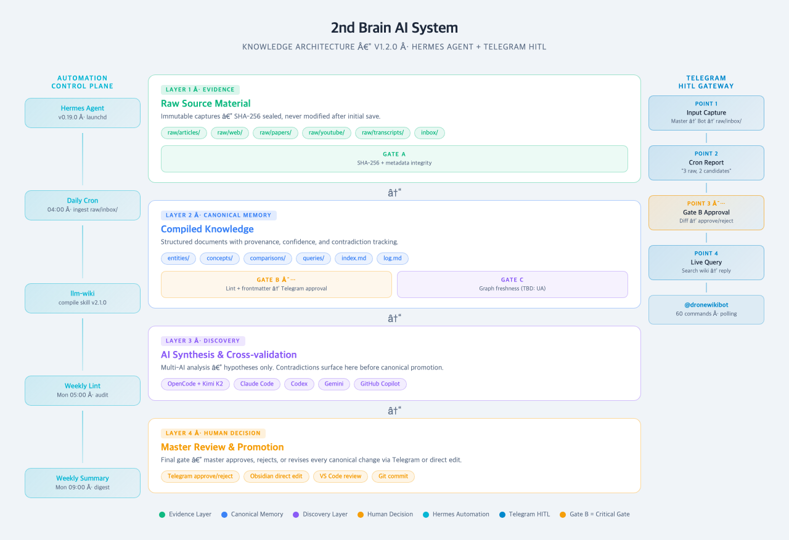
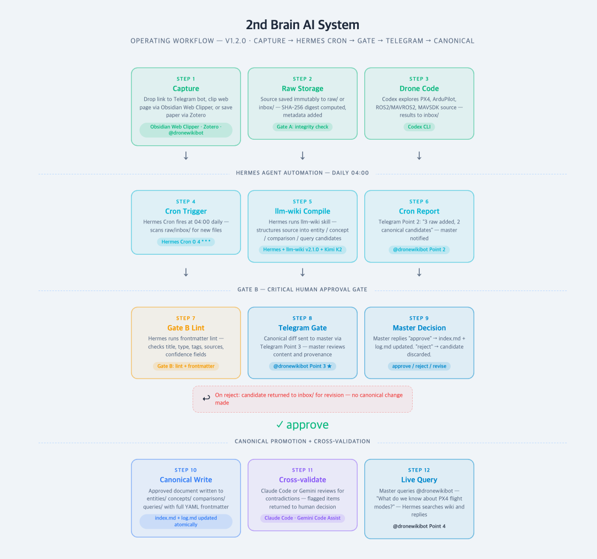
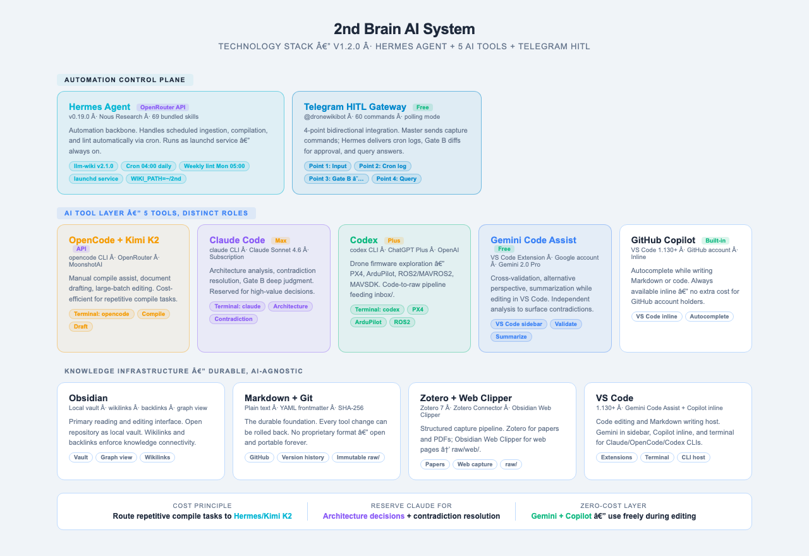

# 2nd Brain AI System

[Stage 0-R follow-up verification](docs/STAGE_0R_FOLLOWUP.md)

> **Stage 0-R current override (2026-09-14):** source of truth=`~/2nd`; public snapshot=`drone-wiki-web/data/wiki`. Sync now audits only. Existing hashes are retention-only; changed/new bytes require publication approval. GraphRAG reads `drone-knowledge-graph.json` plus unverified `discovery-knowledge-graph.json`. Production query vectors require unavailable local Python under the current build, so keyword fallback is expected; live invocation is UNKNOWN. Self-update scheduled `--apply` writes canonical. Discovery extraction still uses OpenRouter and optional Neo4j; kinetic legacy notification can still call Hermes. Do not infer that every subsystem is subscription-only or entirely Hermes-free. Current evidence/limitations: [Stage 0-R](docs/STAGE_0R_REBASELINE.md).

**English** | [한국어](README.ko.md)

> A drone-domain knowledge management system built on Markdown and Git — powered by **launchd + `claude -p` automation + 5-AI tool stack + a human-approved AI research loop**.

## Plan · Intent · Structure (at a glance)

### Plan — what this builds
A **personal knowledge operations system** for drone technology (flight control, datalinks, hardware, software, AI, swarms, regulation). It runs **capture → compile → discovery → human decision**, and publishes only vetted knowledge to the public wiki [DroneWiki](https://github.com/krill0188/drone-wiki-web). Papers, vendor documents, news, videos, patents and government notices are collected daily; AI organizes and links them, but **nothing is finalized without evidence and approval rules**.

### Intent — why it is built this way
1. **Evidence first**: sources are immutable under `raw/`; knowledge is compiled only as Markdown with traceable provenance.
2. **One source of truth, selective publication**: this repo is canonical; only documents passing the policy/hash gate reach `drone-wiki-web`.
3. **Replaceable tools, durable assets**: Markdown, provenance metadata and Git history are the assets; AI tools and automation engines are swappable layers.
4. **AI proposes, humans decide**: routine compilation is automatic, but research-loop hypotheses and unverified discovery relations become canonical only after human approval.
5. **Structured knowledge**: an ontology (74 classes, relations, reasoning rules) lets downstream apps *compute* part compatibility, mission requirements and cross-discipline effects instead of only retrieving text.

### Structure — four knowledge layers and connected systems

```text
[Capture]  RSS · arXiv (8 domains) · Crossref · KCI · patents · FAA/Federal Register · YouTube (27 channels) · procurement notices · HW vendor / SW registries
   ▼  inbox/ ──(daily-ingest, claude -p)──► canonical (concepts · entities · comparisons · queries)
   │                                          ▲  raw/ evidence (immutable)
   ▼                                          │
[Discovery] discovery graph (AI-extracted, unverified) ──► human review (/discovery-review) ──► promotion to canonical
[Research]  research/ (Planner→Retriever→Hypothesis→Critic→Verifier→Report) ──► master approval ──► per-claim promotion
   ▼
[Publish]  publication gate (policy + hashes) ──► auto-publish (daily 10:30 KST) ──► drone-wiki-web/data/wiki ──► Vercel
```

| Area | Location | Size (measured 2026-10-24) |
|---|---|---|
| Canonical concepts / entities / comparisons / queries | `concepts/` `entities/` `comparisons/` `queries/` | 3,199 / 56 / 4 / 2 (of which 2,366 are auto-promoted, unreviewed stubs) |
| Source evidence | `raw/` | 532 files |
| Capture queue / processed | `inbox/` | 1,786 files |
| Research-loop output | `research/` | 73 files |
| Ontology | `ontology/class-hierarchy.json` · `docs/ONTOLOGY_SPEC.md` | 74 classes (incl. 10 topic classes, NewsDigest, VendorRegistry); reasoning rules live in drone-wiki-web |
| Automation | `scripts/` + launchd `ai.2nd.*` | 161 scripts, 10 loaded `ai.2nd.*` jobs (one belongs to a separate project) |
| Publication policy | `publication/policy.json` | document-hash approval; `ontology/` is review-only |

### GitHub status
- Public repository created 2026-07-26. Language mix: Python ≈ 415KB · Shell ≈ 180KB · HTML ≈ 31KB (automation-centric).
- Release history: **v3.2.2** (Aug 19, scholarly collection expansion) → **v3.3.0** (Aug 20, Palantir-style ontology Link + Action) → **v3.4.0** (Sep 2, hermes cron moved to Claude Pro subscription) → **v3.5.0** (Sep 3, local AI drone builder) → **v3.6.0** (Oct 9, auto-publish stabilization) → **v3.7.0** (Oct 17, HW collection expansion, below).
- Companion repo: [`drone-wiki-web`](https://github.com/krill0188/drone-wiki-web) — Next.js app serving the public snapshot (AI Q&A, GraphRAG, ontology reasoning, drone builder).

### Latest update (v3.8.0, 2026-10-24)
- **Discovery bulk promotion**: 1,791 pending discovery concepts promoted in one pass **without model calls** (name, class, sources and graph neighbours only). Each stub is marked `confidence: low` + tag `unreviewed`, and linked to 11 generated classification / source hubs (`concepts/auto-hub-*.md`) so the canonical-link lint rule holds without inventing relations. Together with the master's manual promotions, canonical docs went 909 → 3,275 (embeddings 3,934, canonical graph 3,275 nodes / 14,072 edges).
- **Not a factual basis**: these stubs carry no claims. Facts still come only from quote-verified claims (`claims.json`, `paper-claims.json`) and `^[source]` sentences; the next step is LLM-proposed, code-verified (literal quote match) claim extraction.
- **Ontology**: `NewsDigest` and `VendorRegistry` classes added (parent `DataArtifact`); 52 product/news documents classified through `ontology/class-approvals-20261024b.json` (reversible with `scripts/revert-class-approvals.py`).
- **Pipeline hardening**: `publication-gate.py` / `build-canonical-graph.py` re-exec into `.venv` when PyYAML is missing; the daily pipeline no longer aborts when a few documents fail extraction (`PARTIAL_EXTRACTION_CONTINUE`).
- **Web side (drone-wiki-web)**: key-pool fallback for NVIDIA NIM / OpenRouter, wiring diagram and per-stage images in the builder, four-condition guide cards, cloud monitoring via GitHub Actions. See that repository's `docs/RELEASES.md`.

### Previous update (v3.7.0, 2026-10-17)
- **HW-focused collection**: five arXiv topic feeds (motor/ESC, propeller, power, frame, payload) and five new ontology classes (Propeller/Battery/Frame/Datalink/Payload).
- **61 HW items compiled**: 7 product catalogs, 6 research, 4 cases, 2 entities (manufacturer-official specs).
- **Publication pipeline**: 19 new canonical files auto-approved and registered; baseline re-pinned (daily 10:30 publish pending).
- **Collection expansion (awaiting approval)**: 12 proposed new domains for the drone+α base structures, heterogeneous links/protocols/frequencies and eight engineering disciplines; HW vendor registry (15 categories) and SW registry (12 categories) are staged in `~/projectm/hw-collection` (not yet in the wiki).

### Limitations
- Not every subsystem is subscription-only (discovery extraction uses OpenRouter; legacy Hermes path remains for kinetic notifications). See the Stage 0-R override above.
- 2,366 canonical documents are auto-generated and unreviewed; treat them as navigation aids, not evidence. Nodes whose slug is not ASCII use a `ko-<hash>` slug because the wikilink lint only accepts `[a-z0-9-]`.
- Production search on the public snapshot is expected to fall back to keyword retrieval (live invocation logs: UNKNOWN).
- The new registries' license/integration columns are not yet sample-verified, and sites that block bots (e.g., official ROS docs) are blank.

---

## Project Overview

This project is a personal knowledge management system specialized in **drone technology** (8 subject areas: drone / datalink / swarm / voice-control / drone-hw / drone-sw / drone-ai / ai-agent). It implements a continuous **capture → compile → discovery → human decision** workflow using plain Markdown files — compatible with Obsidian, VS Code, GitHub, and any Markdown-compatible tool.

Built on [ains-lab/2nd-brain-template](https://github.com/ains-lab/2nd-brain-template) with a custom AI tool layer, launchd + `claude -p` automation, and an AI research loop (`research/`).

### Architecture

The system consists of four knowledge layers: **Evidence → Canonical Memory → Discovery → Human Decision**. Raw source material is preserved as immutable evidence under `raw/`; reusable knowledge is compiled into canonical Markdown with traceable provenance.

An **Automation Control Plane** (native macOS `launchd`, label prefix `ai.2nd.*`, calling `claude -p` against the Claude Pro/Max subscription) handles scheduled ingestion, compilation, and lint automatically — see "Automation Control Plane" below for the full chain. **Routine daily-ingest compilation has no pre-approval step** — it compiles canonical pages immediately once its own conditions are met, logs the change to `log.md`, and a daily Telegram report notifies the master of what was created (visibility, not a blocking gate). **The only place human approval actually blocks finalization is the `research/` AI research loop** — AI-generated hypotheses/insights require the master to explicitly `approve` via `research-run.sh` and to name specific claims via `research-promote.py` before anything reaches canonical (see "AI Research Loop" below).



### Operating Workflow

There are two separate paths.

1. **Routine compilation path (no pre-approval)**: Capture → `ai.2nd.daily-fetch` (launchd, `fetch-inbox.sh`) → `ai.2nd.daily-ingest` (`claude -p`) auto-compiles → logged to `log.md` → daily 11:30 Telegram post-hoc notification (list of new pages, via `ai.2nd.morning-report`). `scripts/gate-c-analyze.sh` (graph structural gap analysis) runs separately and periodically.
2. **AI research loop (pre-approval enforced)**: research goal → Planner→Retriever→Hypothesis→Critic→Verifier→Report (5 LLM calls) → master approval (`approve`/`reject`) → individually-selected claim promotion (`research-promote.py`). Only this path actually blocks canonical writes pending approval.



### Technology Stack

The stack combines launchd + `claude -p` automation with five AI tools, each assigned to a distinct role. Open-format Markdown, provenance metadata, and Git history are the durable assets; AI tools and automation engines are the replaceable layer.



---

## Automation Control Plane — launchd + `claude -p`

> Native launchd is the observed scheduler. Ingest and weekly Claude jobs use
> `claude -p`; discovery extraction still uses OpenRouter and optional Neo4j.
> Legacy Hermes paths remain, and kinetic notification can still call Hermes.
> `hermes-wrap.sh` dispatches notifications through the existing notify script.

The daily calendar below is a set of independent jobs, not a completion-ordered chain.

| Order | launchd label | Time | Script | Role |
| --- | --- | --- | --- | --- |
| 1 | `ai.2nd.daily-fetch` | 07:30 | `hermes-wrap.sh` → `scripts/fetch-inbox.sh` | Pulls from 8+ sources (RSS, arXiv ×8 domain queries, Crossref, KCI, USPTO, US Federal Register/FAA, YouTube ×27 channels, 나라장터) into `inbox/` |
| 2 | `ai.2nd.daily-ingest` | 08:00 | `scripts/daily-ingest-claude.sh` (`claude -p`) | Compiles `inbox/` into canonical `concepts/`/`entities/`/`comparisons/`/`queries/` using the `summarize-note` and `publish-entry` skills; moves processed files to `inbox/processed/` |
| 3 | `ai.2nd.lint-knowledge` | 08:12 | `scripts/lint-knowledge.py --recent-hours 2 --quiet` | Schema gate on anything ingested in the last run — enforces the 9-field canonical contract |
| 4 | `ai.2nd.dronewiki-self-update` | 08:20 | `.hermes/scripts/dronewiki-self-update.sh --apply` | Existing automatic canonical news-section writes; not proposal-only. Completion ordering is unresolved. |
| 5 | `ai.2nd.sync-dronewiki` | 08:30 | compatibility wrapper → repository `sync-wiki.sh` → `publication-preflight.py` | Stage 0-R audit only: lint, kinetic check, embeddings freshness, publication policy; no snapshot writes/push/deploy |
| 6 | `ai.2nd.extract-knowledge-graph` | 08:45 | `scripts/extract-knowledge-graph.sh --limit 15` | Extracts the unverified *discovery* graph from raw sources (never mixed with the canonical graph) |
| 7 | `ai.2nd.update-knowledge-graph` | 08:47 | `scripts/update-graph.sh` | Updates the canonical graph from all four canonical directories (legacy stale nodes can remain) |
| 8 | `ai.2nd.apply-kinetic-rules` | 08:50 | `scripts/apply-kinetic-rules.py` | Runs the two implemented SWRL rules (Rule 4: SLM/LLM classification, Rule 6: unapproved-hypothesis audit) |
| 9 | `ai.2nd.morning-report` | 11:30 | `scripts/morning-report-send.sh` | Sends the existing morning report; not a success receipt for the new gated pipeline |

Weekly, independent of the daily chain:

| launchd label | Time | Script | Role |
| --- | --- | --- | --- |
| `ai.2nd.weekly-lint` | Mon 05:00 | `scripts/weekly-lint-claude.sh` (`claude -p`) | Orphan pages, broken wikilinks, SHA-256 drift |
| `ai.2nd.weekly-summary` | Mon 05:30 | `scripts/weekly-summary-claude.sh` (`claude -p`) | Weekly knowledge digest to Telegram |

Also scheduled on this same `ai.2nd.*` launchd namespace, but belonging to an **unrelated separate
project**: `ai.2nd.medic-wiki-fetch` runs `~/medic-wiki/scripts/fetch-inbox.sh` (its own Supabase
backend, nothing to do with this repo's content). It only shares the scheduler, not the data.

### Inspecting or changing the schedule

```bash
launchctl list | grep ai.2nd                              # is it loaded? last exit code?
plutil -p ~/Library/LaunchAgents/ai.2nd.daily-ingest.plist # see a job's schedule/paths
# after editing a plist:
launchctl unload ~/Library/LaunchAgents/ai.2nd.<name>.plist
launchctl load   ~/Library/LaunchAgents/ai.2nd.<name>.plist
```

All daily jobs are scheduled **after 07:00 KST on purpose** — that's when the Claude subscription's
weekly usage limit resets. Jobs used to run 03:30–04:50 and would occasionally fail with
"you've hit your spend limit" right up until the reset (see incident:
`docs/incident-reports/2026-09-11-briefing-outage/`). If you ever need to shift these times again,
keep the whole chain's *relative* spacing intact (fetch → +30m ingest → +12m lint → ... ) rather
than moving one job in isolation — two jobs sharing a time slot is a silent failure mode, not an error.

### Telegram — notification/query channel, not an approval gate

```
[Input]     Master → Telegram → (manual capture, see "Quick Start") → inbox/
[Post-hoc]  ai.2nd.morning-report (11:30) → Telegram: today's canonical pages + drone news digest
[Query]     Master → Telegram (dronewikibot) → wiki search → answer
```

> Telegram is a **post-hoc notification/query channel, not a blocking approval gate**.
> Daily-ingest does not wait for a Telegram reply — it updates `index.md`/`log.md` immediately.
> The only point where approval actually blocks finalization is `research-run.sh approve` /
> `research-promote.py` in the AI research loop below (CLI-based, not Telegram), and the
> `/self-update-review` and `/discovery-review` pages in drone-wiki-web (human-gated, local-only).

---

## AI Tool Roles

Five tools are configured for this system — each with a distinct responsibility defined in [AGENTS.md](AGENTS.md).

| Tool | Interface | Primary Role |
| --- | --- | --- |
| **launchd + `claude -p`** | macOS scheduler / CLI | Automated ingestion, compilation, lint (finalized immediately, no pre-approval), Telegram notice afterward |
| **OpenCode + Kimi K2** | Terminal (`opencode`) | Manual compile assist, document drafting, large-batch editing |
| **Claude Code** | Terminal (`claude`) | Architecture analysis, contradiction review, running the AI research loop (Planner–Report) |
| **Codex** | Terminal (`codex`) | Drone firmware exploration (PX4/ArduPilot/ROS2), code-to-raw pipeline |
| **GitHub Copilot Chat** | VS Code sidebar (`@workspace`) | Cross-validation, alternative perspective, summarization — reads workspace files directly |
| **GitHub Copilot Inline** | VS Code inline | Autocomplete while writing Markdown or code |
| **Understand Anything** | `scripts/gate-c-analyze.sh` / Claude Code | Gate C — knowledge graph generation, gap analysis, structural observation |

> **Cost principle**: Daily/weekly automation already runs on the Claude Pro/Max subscription (`claude -p`), so there's no separate per-call cost to manage there. Route ad-hoc large-batch manual compiling to Kimi K2. Reserve interactive Claude sessions for architecture decisions and contradiction resolution. GitHub Copilot (inline + Chat) is free — use freely during editing and cross-validation.

---

## Drone Domain Coverage

The primary knowledge domain is **drone technology** across 8 registered tag categories (see [SCHEMA.md](SCHEMA.md) and [docs/domain/drone-domain-guide.md](docs/domain/drone-domain-guide.md)).

| Tag | Scope |
| --- | --- |
| `drone` | General systems — airframes, flight mechanics, regulations, mission planning |
| `datalink` | RF, LTE, MAVLink telemetry, C2 link, encryption |
| `swarm` | Multi-drone coordination, formation flight, consensus algorithms |
| `voice-control` | Natural language / voice command interfaces for drone operation |
| `drone-hw` | Hardware — FC, ESC, motors, batteries, LiDAR, cameras, payloads |
| `drone-sw` | PX4, ArduPilot, GCS, MAVSDK, ROS/ROS2, MAVROS/MAVROS2, uORB |
| `drone-ai` | Computer vision, autonomous flight, SLAM, object detection, segmentation |
| `ai-agent` | AI agent architectures, autonomous decision-making, multi-agent systems |

Collection priority: `drone-sw` → `datalink` → `drone-ai` → `swarm` → others.

---

## Key Features

| Feature | Description |
| --- | --- |
| **Automated ingestion pipeline** | `ai.2nd.daily-fetch` (launchd, 07:30) fills `inbox/`, `ai.2nd.daily-ingest` (08:00, `claude -p`) compiles it, and **finalizes canonical pages immediately, with no pre-approval step**. An 11:30 morning report notifies the master via Telegram of what was created that day, after the fact. |
| **AI research loop — the actual human approval gate** | Approval only blocks finalization in `research/`: a research session (Planner–Report) produces a draft, the master must explicitly `approve` it via `research-run.sh`, and must name specific claims via `research-promote.py --items` for them to reach canonical. `fact`-type claims (restating an existing source) are refused outright. |
| **Source and provenance preservation** | Capture papers and web material with Zotero and Obsidian Web Clipper, then preserve the source, metadata, and SHA-256 digest under `raw/` so every claim can be traced to evidence. |
| **Verified knowledge compilation** | `ai.2nd.daily-ingest` (`claude -p`) and OpenCode + Kimi K2 structure source material into entity, concept, comparison, and query documents with provenance, confidence ratings, and contradiction tracking. |
| **Connected Markdown editing** | Read and edit durable knowledge in Obsidian using wikilinks and backlinks; GitHub Copilot inline assists while editing. |
| **Multi-AI cross-validation** | Claude Code and GitHub Copilot Chat (`@workspace`) can provide independent analysis of the same evidence — but this is a manual check a human runs when warranted, not an automatic gate that runs before daily-ingest compilation. |
| **Drone code exploration** | Codex navigates PX4, ArduPilot, ROS2/MAVROS2, and MAVSDK source code; results are saved to `inbox/` and picked up by `ai.2nd.daily-ingest` for compilation. |
| **Knowledge graph (Gate C)** | Understand Anything `understand-knowledge` skill analyzes the wiki and produces an interactive knowledge graph (`.ua/knowledge-graph.json`) — clusters, gaps, and structural weak links surfaced automatically. Open the local viewer with `open .ua/graph.html` (force-directed, interactive, works offline). |
| **Gate C v2 — AI gap analysis** | `scripts/gate-c-analyze.sh` reads the knowledge graph, pre-processes structure stats (layer density, isolated nodes, high-degree hubs, disconnected layer pairs), and pipes them to `claude -p` for AI interpretation. Output is a Telegram-formatted gap report saved to `.ua/gap-report.md`. Run with `--deliver` to push via `scripts/hermes-wrap.sh` (direct Telegram Bot API call, no gateway process involved). |

---

## Prerequisites

### Capture Tools

| Category | Tool | Purpose |
| --- | --- | --- |
| Required | [Obsidian](https://obsidian.md/download) | Open this repository as a local vault to browse and edit Markdown. |
| Paper capture | [Zotero + Zotero Connector](https://www.zotero.org/download/) | Scrape papers from the browser → Zotero library → `python3 scripts/zotero-ingest.py` → `raw/papers/<topic>/`. Requires Zotero Settings → Advanced → "Allow other applications" enabled. |
| Web capture | [Obsidian Web Clipper](https://obsidian.md/clipper) | Convert web pages into `raw/web/` Markdown files. |

### Automation & Messaging

| Tool | Purpose | Setup |
| --- | --- | --- |
| macOS `launchd` | Automation control plane — all `ai.2nd.*` scheduled jobs (see "Automation Control Plane" above) | Plists live in `~/Library/LaunchAgents/ai.2nd.*.plist`; `launchctl load` each one |
| Claude Pro/Max subscription | Every `claude -p` call in the automation chain runs against this, not an API key | `claude` — login via browser once; no `ANTHROPIC_API_KEY` needed or used |
| Telegram Bot | Capture-command intake + post-hoc notification/query channel (not an approval gate) | Create via [@BotFather](https://t.me/BotFather), set token as `DRONEWIKI_BOT_TOKEN`/`ALLOWED_CHAT_ID` in `claudeclaw/.env` (read by `notify.sh`/`notify-dronewiki.sh`) |

### AI Tools

| Tool | Auth Method | Setup |
| --- | --- | --- |
| [OpenCode](https://opencode.ai) + Kimi K2 | OpenRouter API key | `opencode providers login openrouter` in terminal |
| [Claude Code](https://claude.ai/code) | Claude Max subscription | `claude` — login via browser on first run |
| [Codex](https://github.com/openai/codex) | ChatGPT Plus subscription | `codex` — login via browser on first run |
| [GitHub Copilot](https://github.com/features/copilot) | GitHub account (built-in) | Built into VS Code 1.130+; sign in with GitHub. Provides both inline completions and Chat (`@workspace`) |

### Recommended Setup Order

1. Clone this repository and open it in Obsidian as a vault.
2. Install Zotero, Zotero Connector (Chrome), and Obsidian Web Clipper. Enable Zotero local API: Settings → Advanced → "Allow other applications on this computer to communicate with Zotero". Install zotero-mcp: `pipx install zotero-mcp-server`.
3. Install OpenCode, Claude Code CLI, and Codex CLI via npm.
4. Sign in to GitHub Copilot in VS Code (built-in from v1.130+); use Copilot Chat (`@workspace`) for cross-validation.
5. Load the automation plists: `for p in ~/Library/LaunchAgents/ai.2nd.*.plist; do launchctl load "$p"; done`
6. Set `DRONEWIKI_BOT_TOKEN` and `ALLOWED_CHAT_ID` in `claudeclaw/.env` for Telegram delivery.
7. Verify with `launchctl list | grep ai.2nd` — every job should show a `0` last-exit-code (`-` PID means idle, which is normal between scheduled runs).

---

## Directory Structure

```text
.
├── inbox/                    # Temporary intake — ai.2nd.daily-fetch (07:30) fills it, ai.2nd.daily-ingest (08:00) drains it
├── raw/                      # Immutable source evidence
│   ├── articles/             # Article and web-clipping source text
│   ├── notebooklm/           # NotebookLM source records
│   ├── papers/files/         # Paper attachments (placeholder only)
│   ├── transcripts/          # Audio, video, and meeting transcripts
│   ├── web/                  # Web captures (importer-preserved paths)
│   ├── youtube/              # YouTube metadata and transcripts
│   └── assets/               # Images referenced by source records
├── entities/                 # Canonical knowledge — people, orgs, tools
├── concepts/                 # Canonical knowledge — concepts, principles
├── comparisons/              # Canonical side-by-side analysis
├── queries/                  # Source-grounded questions and answers
├── docs/
│   ├── architecture/         # System architecture diagram and spec
│   ├── domain/               # Drone domain collection guide
│   ├── tech-stack/           # Technology stack diagram
│   └── workflow/             # Operating workflow diagram
├── templates/                # Frontmatter templates (raw-article / entity / concept / comparison / query)
├── _archive/                 # Superseded canonical pages
├── AGENTS.md                 # AI tool role definitions and domain focus
├── CLAUDE.md                 # Claude Code specific instructions
├── SCHEMA.md                 # Authoritative data contract
├── index.md                  # Active canonical knowledge catalog
└── log.md                    # Append-only operation history
```

---

## Quick Start

### 1. Clone the Repository

```bash
git clone https://github.com/krill0188/2nd-brain-ai-system.git
cd 2nd-brain-ai-system
```

### 2. Open in Your Editor

- **Obsidian**: `Open folder as vault` → select the repository directory.
- **VS Code**: `code .` or `code ~/2nd` (if cloned to `~/2nd`).

### 3. Start a Knowledge Session

```bash
# Automated pipeline — launchd handles daily ingestion (see "Automation Control Plane")
launchctl list | grep ai.2nd

# Manual compile assist — Kimi K2
cd ~/2nd && opencode

# Architecture / contradiction analysis — Claude
cd ~/2nd && claude

# Drone code exploration — Codex (results go to inbox/)
cd ~/2nd && codex
```

### 4. Send a Capture Command via Telegram

```
[Telegram → @dronewikibot]
"Collect this link and save to inbox/: https://docs.px4.io/..."
```

The capture is saved to `inbox/`, and the next `ai.2nd.daily-ingest` run (08:00) compiles it.

### 5. View the Knowledge Graph

```bash
# Open the interactive Gate C graph viewer (offline, self-contained)
open .ua/graph.html
```

The viewer shows only canonical knowledge domain nodes (Concepts / Comparisons / Queries / Entities) with a force-directed layout — docs, templates, and scaffolding are intentionally excluded. Click any node to see its summary, file path, and connections. Filter by domain or search by name.

### 6. Read the Operating Contract

Before adding knowledge, read [SCHEMA.md](SCHEMA.md), check [index.md](index.md) for subjects already covered, and review the latest entries in [log.md](log.md).

---

## Basic Workflow

1. **Capture**: Drop links into Telegram or save web pages via Obsidian Web Clipper → `raw/web/`. Papers go via Zotero Connector → Zotero library → `python3 scripts/zotero-ingest.py` → `raw/papers/<topic>/`.
2. **Auto-compile (no pre-approval)**: `ai.2nd.daily-ingest` (launchd, 08:00 daily, `claude -p`) scans `inbox/` and compiles and **finalizes** canonical pages immediately — no waiting state, `index.md`/`log.md` are updated right away.
3. **Post-hoc notice**: `morning-report.sh` at 07:30 sends that day's newly-created pages to Telegram (a notice, not an approval request — the pages are already final).
4. **(Optional) Cross-validate**: If warranted, ask GitHub Copilot Chat (`@workspace`) or Claude to review already-created pages for contradictions or missing coverage — a manual, human-initiated check, not an automatic step.
5. **AI research loop (the real approval gate)**: For deeper questions, start a session with `scripts/research-run.sh new "<question>"`. It runs Planner→Retriever→Hypothesis→Critic→Verifier→Report to produce a draft; the master must `research-run.sh approve <id>` and then name specific claims via `research-promote.py <id> --items C1,C3` before anything reaches canonical — **only this path actually blocks finalization pending approval.**
6. **Query**: Ask the Telegram bot directly — `"What did we collect on PX4 flight modes?"` — dronewikibot searches the wiki and replies.
7. **Archive**: Move fully superseded pages to `_archive/`, repair links, and record the operation in `log.md`.

---

## Data Management Principles

> [!IMPORTANT]
> `README.md` is a usage guide; [SCHEMA.md](SCHEMA.md) is the authoritative data contract. Follow `SCHEMA.md` whenever the two appear to differ.

- **Source bodies are immutable.** Do not modify `raw/` content after initial capture.
- **Source paths must exist.** Canonical `sources` may contain only real Markdown files under registered `raw/` directories.
- **Canonical knowledge is selective.** Promote a subject only when it is central to one source or repeated across at least two sources.
- **Canonical knowledge is connected.** Every active canonical page must link to at least two other active canonical pages via `[[wikilinks]]`.
- **Changes are atomic.** Canonical create/update/archive is complete only after updating `index.md` and appending to `log.md` together.
- **No secrets in Git.** Never commit API keys, bot tokens, or login sessions to this repository. Keep `~/.hermes/.env` local-only.

---

## Synchronization

```bash
git add .
git commit -m "feat: add drone-sw canonical pages (PX4 architecture)"
git push
```

Use Git for history. Never store API keys, tokens, or login sessions in the repository.

---

## License

Based on [ains-lab/2nd-brain-template](https://github.com/ains-lab/2nd-brain-template). Adapted and extended for drone-domain AI knowledge management with launchd + `claude -p` automation and a human-approved AI research loop (`research/`).
